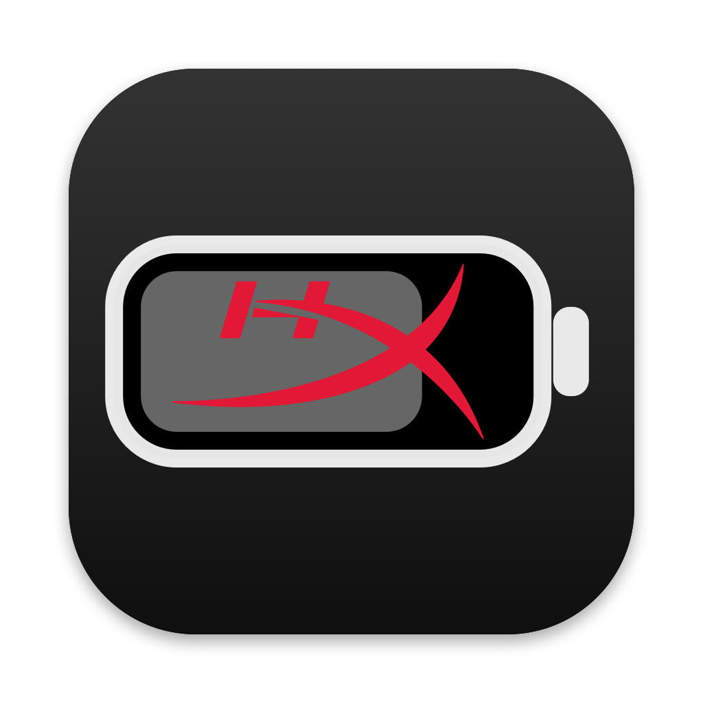
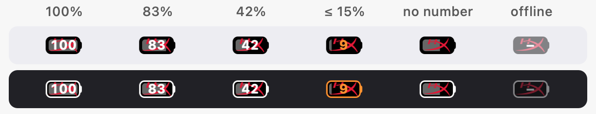
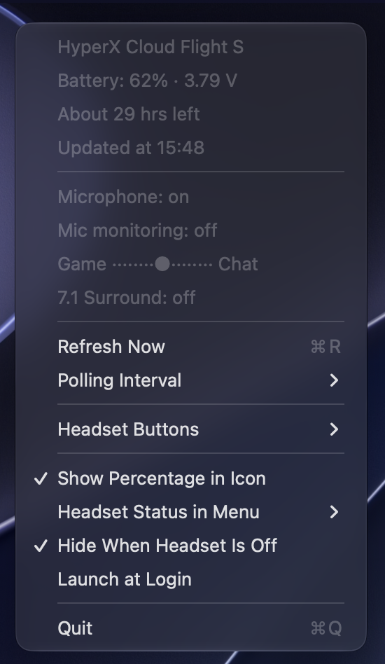

<p align="center">
  
</p>

<h1 align="center">HyperX Battery for macOS</h1>

<p align="center">
  A native menu bar app for the <b>HyperX Cloud Flight S</b> wireless headset:<br>
  battery level, headset buttons as media keys or HyperX functions, and switching the sound output.
</p>

<p align="center"><a href="README.ru.md">Русская версия</a></p>

<p align="center">
  
</p>

<p align="center">
  
</p>

This is a macOS port of [CubE135/hyperx-cloud-flight-s-battery-monitor](https://github.com/CubE135/hyperx-cloud-flight-s-battery-monitor), an Electron app for Windows. It is rewritten from scratch in Swift with IOKit and CoreAudio. It has no dependencies and is about 300 KB.

## Features

- **Battery in the menu bar.** The icon is a compact battery. It is filled to the charge level and shows the percentage. Below 15% the numbers turn orange.
- **Menu.** It shows the charge, the voltage and the last update time. If the headset is off, it shows the last known value.
- **Estimated time left.** The app learns how fast your headset drains: it adds up the percent lost and the hours the headset was actually on. Time while the headset is off, the Mac sleeps, the headset charges or sits at 100% on the cable is ignored, and so is the ±1% jitter of the readings. The estimate covers roughly the last 100 hours of use, so it follows battery wear and your habits. It appears after a few hours of use.
- **Headset status.** The menu shows what the headset itself keeps: microphone on or muted, mic monitoring, game/chat balance (which side is attenuated and by how many dB) and 7.1 surround. The app asks the headset for its status when it connects and whenever the menu opens, and updates it as the buttons are pressed. Each line can be hidden under **Headset Status in Menu**.
- **Headset buttons.** The four buttons on the left ear cup work as Mac media keys or switch the sound output. Each button can have its own single-press and double-press action. A button can also get one of the HyperX functions that the headset runs itself, as in NGENUITY. The app writes the button setup to the headset, so Windows and NGENUITY are no longer needed.
- **Hiding the icon when the headset is off.** On by default. When the icon is hidden, open the app again from Applications or Spotlight and the icon comes back for a minute.
- **Reconnecting.** The app picks up a dongle plugged in or out on the fly, the headset being turned on, and the Mac waking from sleep.
- **Settings.** Polling interval: 1, 5, 15, 30 or 60 minutes. Launch at login.
- **Languages.** The interface is in English and Russian and follows the system language.

## Install

You need macOS 13 or later. The app is a universal binary for Apple Silicon and Intel.

### Download

1. Download `HyperX-Battery-<version>.zip` from [Releases](https://github.com/TERABAYTYCH/hyperx-cloud-flight-s-macos/releases/latest), unzip it and move **HyperX Battery.app** to Applications.
2. The app has an ad-hoc signature and is not notarized, so macOS blocks it on first launch. To allow it, use either way:
   - open the app once, then go to System Settings → Privacy & Security and click **Open Anyway** next to the message about HyperX Battery;
   - or remove the quarantine flag in Terminal:

     ```bash
     xattr -dr com.apple.quarantine "/Applications/HyperX Battery.app"
     ```

### Build from source

You need the Command Line Tools (`xcode-select --install`).

```bash
git clone https://github.com/TERABAYTYCH/hyperx-cloud-flight-s-macos.git
cd hyperx-cloud-flight-s-macos
./build.sh
cp -R "build/HyperX Battery.app" /Applications/
open "/Applications/HyperX Battery.app"
```

A self-built app is not quarantined and opens right away.

## Headset buttons

| Button | Single press | Double press |
|---|---|---|
| Up | Play/Pause | Sound output → Mac speakers |
| Left | Next track | — |
| Right | Previous track | — |
| Down | Mute | Sound output → HyperX Game |
| 7.1 | nothing (the headset switches surround itself) | — |

You can change the actions in the menu under **Headset Buttons**. Available actions:
- Play/Pause, next track, previous track;
- mute, volume up, volume down;
- sound output to HyperX Game, HyperX Chat or the Mac speakers.

**HyperX functions (in headset).** A separate section of each button's submenu. These are the same functions as in NGENUITY, and the headset runs them itself, without the Mac:
- mic monitoring (hear yourself in the headset);
- game/chat balance: more game or more chat;
- mute the microphone.

The headset stores one mode per button: either one of these functions or "multimedia" (it just reports the press to the Mac). So:
- choosing a Mac action for a button, single or double press, switches the button to multimedia automatically (a double-press action replaces the HyperX function on the single press with "Nothing");
- choosing a HyperX function turns off the double press on that button: the headset reacts to every press, so a double press cannot be told apart. The 7.1 button has no HyperX functions.

The app writes the modes to the headset whenever the setup changes and every time the headset connects. If the buttons were set up differently in NGENUITY, the app overwrites that with its own setup.

A double press is a second press of the same button within 300 ms. If a button has a double-press action, its single press fires after that delay. Buttons without one react instantly.

**Requirements**

1. **Accessibility permission for media keys.** Go to System Settings → Privacy & Security → Accessibility and turn on HyperX Battery. **Allow Media Control…** in the menu brings up the system prompt. The buttons start working as soon as the permission is granted, without restarting the app. Switching the sound output does not need the permission.

> The ad-hoc signature changes with every rebuild, and macOS then treats the app as a different one. After an update the toggle may still look on, but the old permission no longer applies. Choose **Allow Media Control…** in the menu: the app resets its stale entry and shows the system prompt again.

## Protocol

The dongle is a single HID device: VID `0x0951`, PID `0x16EA`.

| Direction | Report | Meaning |
|---|---|---|
| → | output `0x06`: `06 00 02 00 9a 00 00 68 4a 8e 0a 00 00 00 bb 02` padded with zeros to 62 bytes | battery request |
| ← | `0b 00 bb 02 00 <mV hi> <mV lo> <%>` | battery reply, e.g. `0f a3 63` = 4003 mV, 99% |
| ← | `0b 00 bb 01 01` / `0b 00 bb 01 03` | headset turned on / is turning off (long press of power) |
| ← | `0b 00 bb 04 <up> <left> <right> <down> <7.1>` | button press, `01` marks the pressed one |
| → | `06 00 02 00 9a 00 00 68 4a 8e 0a 00 00 00 bb 12 01`, then for buttons 0–3 `06 00 02 00 9d 00 00 68 4a 8e <button> 00 00 00 <mode>` | button modes. Buttons: 0 up, 1 left, 2 right, 3 down. Modes: `00` multimedia, `01` mic monitoring, `02` game mix, `03` chat mix, `04` mic mute |
| ← | `0a 00 <dsp> 03 <flags> 00 <chat> xx 00 00 <game> xx` | status, sent on every change: `dsp & 02` 7.1 on; `flags & 02` mic muted, `flags & 10` mic monitoring; `chat`/`game` attenuation in dB as int8 (`00, fe, fc, f9, f5, f1, eb, e1` = 0 … −31 dB), `80` = off |
| → | output `0x06`: `06 00 00 00 ff 00 00 68 4a 8e` padded with zeros | status request (as in [HyperHeadset](https://github.com/LennardKittner/HyperHeadset)) |
| ← | input `0x07`: `07 00 04 00 ff 00 00 68 4a 8e` + the same `0a …` status from byte 10 | status reply |
| ← | consumer `02 01` / `02 02` | volume wheel, handled by macOS itself |

A short press of the power button sends nothing. Raw captures are in [`docs/captures`](docs/captures). They were recorded with the button logger before the app existed. The button-mode command was captured from NGENUITY on Windows with a debugger and checked from the Mac.

How this differs from the Windows version:

| | Windows (original) | macOS (this port) |
|---|---|---|
| Interface lookup | a separate HID device with `usagePage 0xFF13` | one device, with the `0xFF13` collection inside it |
| Reply | 62 bytes (hidapi pads to the maximum) | input report `0x0B`, 12 bytes |
| Parsing | by length `0x3E` | by content |

## Development

```bash
HYPERX_DEBUG=1 "build/HyperX Battery.app/Contents/MacOS/HyperXBattery"   # all HID reports and actions to stderr
swiftc tools/hidguide.swift -o build/hidguide && build/hidguide build/capture.log   # step-by-step button logger
tools/makeicons.sh   # build AppIcon.icns from docs/app-icon.png and redraw docs/menu-bar-icons.png
```

| Path | Contents |
|---|---|
| `Sources/HeadsetMonitor.swift` | HID: battery requests and parsing headset events |
| `Sources/ButtonActions.swift` | buttons, actions, double press, media keys |
| `Sources/AudioOutput.swift` | switching the sound output via CoreAudio |
| `Sources/BatteryEstimator.swift` | estimating the time left from the collected drain statistics |
| `Sources/BatteryIcon.swift`, `HyperXLogo.swift` | drawing the menu bar icon |
| `Sources/main.swift` | the menu, settings, permission, autostart |
| `Resources/*.lproj` | localization: the keys are the English strings from the code |

## License and credits

This project is licensed under [MIT](LICENSE).

- Protocol and idea: [CubE135/hyperx-cloud-flight-s-battery-monitor](https://github.com/CubE135/hyperx-cloud-flight-s-battery-monitor), MIT.
- The “hX” outline comes from [Simple Icons](https://simpleicons.org) (CC0).

HyperX and the HyperX logo are trademarks of HP Inc. This is an unofficial project. It is not affiliated with or endorsed by HP Inc. or HyperX.
