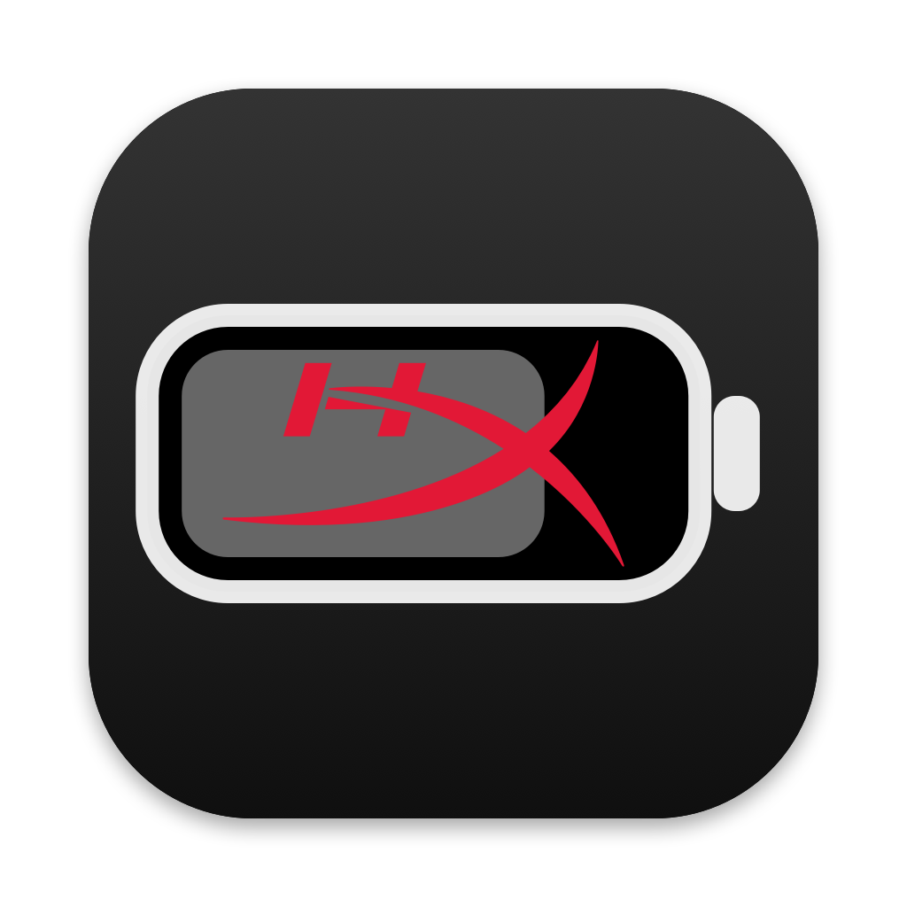
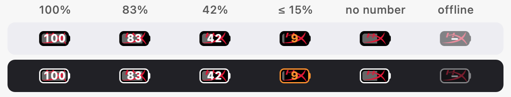
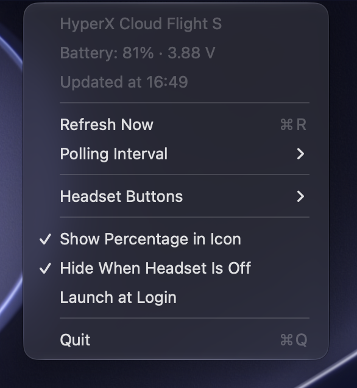

<p align="center">
  
</p>

<h1 align="center">HyperX Battery for macOS</h1>

<p align="center">
  A native menu bar app for the <b>HyperX Cloud Flight S</b> wireless headset:<br>
  battery level, headset buttons as media keys, and switching the sound output.
</p>

<p align="center"><a href="README.ru.md">Русская версия</a></p>

<p align="center">
  
</p>

<p align="center">
  
</p>

This is a macOS port of [CubE135/hyperx-cloud-flight-s-battery-monitor](https://github.com/CubE135/hyperx-cloud-flight-s-battery-monitor), an Electron app for Windows. It is rewritten from scratch in Swift with IOKit and CoreAudio. It has no dependencies and is about 300 KB.

## Features

- **Battery in the menu bar.** The icon is a compact battery, no wider than AlDente's. It is filled to the charge level and shows the percentage. Below 15% the numbers turn orange.
- **Menu.** It shows the charge, the voltage and the last update time. If the headset is off, it shows the last known value.
- **Headset buttons.** The four buttons on the left ear cup work as Mac media keys or switch the sound output. Each button can have its own single-press and double-press action.
- **Hiding the icon when the headset is off.** On by default. When the icon is hidden, open the app again from Applications or Spotlight and the icon comes back for a minute.
- **Reconnecting.** The app picks up a dongle plugged in or out on the fly, the headset being turned on, and the Mac waking from sleep.
- **Settings.** Polling interval: 1, 5, 15, 30 or 60 minutes. Launch at login.
- **Languages.** The interface is in English and Russian and follows the system language.

## Install

You need macOS 13 or later. The app is a universal binary for Apple Silicon and Intel.

### Download

1. Download `HyperX-Battery-<version>.zip` from [Releases](https://github.com/TERABAYTYCH/hyperx-cloud-flight-s-macos/releases/latest), unzip it and move **HyperX Battery.app** to Applications.
2. The app has an ad-hoc signature and is not notarized, so macOS blocks it on first launch. To allow it, use either way:
   - open the app once, then go to System Settings → Privacy & Security and click **Open Anyway** next to the message about HyperX Battery;
   - or remove the quarantine flag in Terminal:

     ```bash
     xattr -dr com.apple.quarantine "/Applications/HyperX Battery.app"
     ```

### Build from source

You need the Command Line Tools (`xcode-select --install`).

```bash
git clone https://github.com/TERABAYTYCH/hyperx-cloud-flight-s-macos.git
cd hyperx-cloud-flight-s-macos
./build.sh
cp -R "build/HyperX Battery.app" /Applications/
open "/Applications/HyperX Battery.app"
```

A self-built app is not quarantined and opens right away.

## Headset buttons

| Button | Single press | Double press |
|---|---|---|
| Up | Play/Pause | Sound output → Mac speakers |
| Left | Next track | — |
| Right | Previous track | — |
| Down | Mute | Sound output → HyperX Game |
| 7.1 | nothing (the headset switches surround itself) | — |

You can change the actions in the menu under **Headset Buttons**. Available actions:
- Play/Pause, next track, previous track;
- mute, volume up, volume down;
- sound output to HyperX Game, HyperX Chat or the Mac speakers.

A double press is a second press of the same button within 300 ms. If a button has a double-press action, its single press fires after that delay. Buttons without one react instantly.

**Requirements**

1. **NGENUITY on Windows, once.** Set all four buttons to multimedia actions in NGENUITY. Otherwise the headset first performs its own action, such as mic monitoring or the game/chat balance. The setting is stored in the headset.
2. **Accessibility permission for media keys.** Go to System Settings → Privacy & Security → Accessibility and turn on HyperX Battery. **Allow Media Control…** in the menu brings up the system prompt. The buttons start working as soon as the permission is granted, without restarting the app. Switching the sound output does not need the permission.

> The ad-hoc signature changes with every rebuild, and macOS then treats the app as a different one. After an update the toggle may still look on, but the old permission no longer applies. Choose **Allow Media Control…** in the menu: the app resets its stale entry and shows the system prompt again.

## Protocol

The dongle is a single HID device: VID `0x0951`, PID `0x16EA`.

| Direction | Report | Meaning |
|---|---|---|
| → | output `0x06`: `06 00 02 00 9a 00 00 68 4a 8e 0a 00 00 00 bb 02` padded with zeros to 62 bytes | battery request |
| ← | `0b 00 bb 02 00 <mV hi> <mV lo> <%>` | battery reply, e.g. `0f a3 63` = 4003 mV, 99% |
| ← | `0b 00 bb 01 01` / `0b 00 bb 01 03` | headset turned on / is turning off (long press of power) |
| ← | `0b 00 bb 04 <up> <left> <right> <down> <7.1>` | button press, `01` marks the pressed one |
| ← | `0a …` | state: mic monitoring, mute, game/chat balance (only for non-multimedia button actions) |
| ← | consumer `02 01` / `02 02` | volume wheel, handled by macOS itself |

A short press of the power button sends nothing. Raw captures are in [`docs/captures`](docs/captures). They were recorded with the button logger before the app existed.

How this differs from the Windows version:

| | Windows (original) | macOS (this port) |
|---|---|---|
| Interface lookup | a separate HID device with `usagePage 0xFF13` | one device, with the `0xFF13` collection inside it |
| Reply | 62 bytes (hidapi pads to the maximum) | input report `0x0B`, 12 bytes |
| Parsing | by length `0x3E` | by content |

## Development

```bash
HYPERX_DEBUG=1 "build/HyperX Battery.app/Contents/MacOS/HyperXBattery"   # all HID reports and actions to stderr
swiftc tools/hidguide.swift -o build/hidguide && build/hidguide build/capture.log   # step-by-step button logger
tools/makeicons.sh   # redraw the app icon and docs/menu-bar-icons.png
```

| Path | Contents |
|---|---|
| `Sources/HeadsetMonitor.swift` | HID: battery requests and parsing headset events |
| `Sources/ButtonActions.swift` | buttons, actions, double press, media keys |
| `Sources/AudioOutput.swift` | switching the sound output via CoreAudio |
| `Sources/BatteryIcon.swift`, `HyperXLogo.swift` | drawing the menu bar icon |
| `Sources/main.swift` | the menu, settings, permission, autostart |
| `Resources/*.lproj` | localization: the keys are the English strings from the code |

## License and credits

This project is licensed under [MIT](LICENSE).

- Protocol and idea: [CubE135/hyperx-cloud-flight-s-battery-monitor](https://github.com/CubE135/hyperx-cloud-flight-s-battery-monitor), MIT.
- The “hX” outline comes from [Simple Icons](https://simpleicons.org) (CC0).

HyperX and the HyperX logo are trademarks of HP Inc. This is an unofficial project. It is not affiliated with or endorsed by HP Inc. or HyperX.
