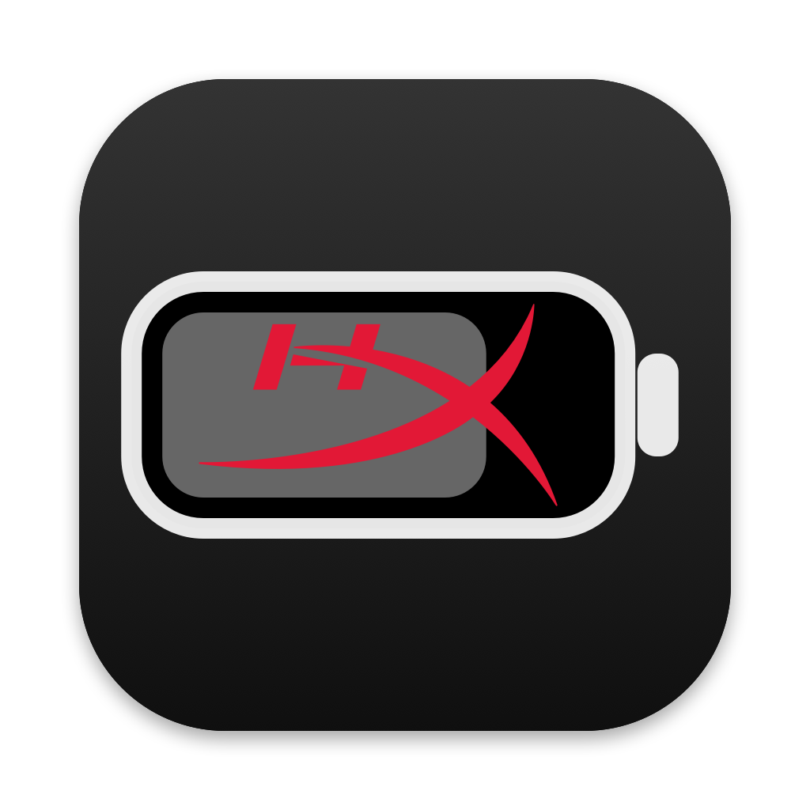
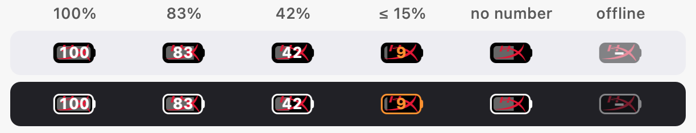
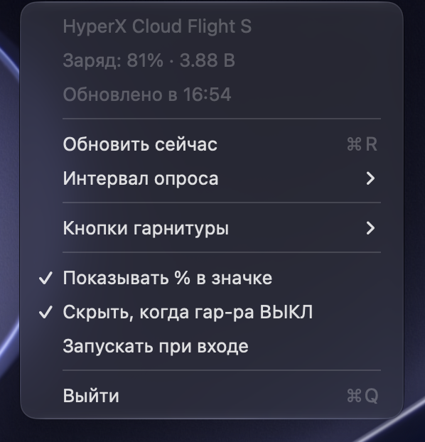

<p align="center">
  
</p>

<h1 align="center">HyperX Battery для macOS</h1>

<p align="center">
  Нативное приложение для строки меню. Работает с беспроводной гарнитурой <b>HyperX Cloud Flight S</b>:<br>
  показывает заряд, превращает кнопки гарнитуры в медиа-клавиши и переключает вывод звука.
</p>

<p align="center"><a href="README.md">English version</a></p>

<p align="center">
  
</p>

<p align="center">
  
</p>

Это порт [CubE135/hyperx-cloud-flight-s-battery-monitor](https://github.com/CubE135/hyperx-cloud-flight-s-battery-monitor) (Electron, только Windows) на macOS. Приложение переписано с нуля на Swift с IOKit и CoreAudio. Зависимостей нет, размер около 300 КБ.

## Что умеет

- **Заряд в строке меню.** Компактная батарейка не шире значка AlDente. Она заполнена по уровню заряда и показывает процент. При заряде 15% и ниже цифры становятся оранжевыми.
- **Меню.** В нём заряд, напряжение и время последнего обновления. Если гарнитура выключена, показывается последнее известное значение.
- **Примерное время работы.** Приложение изучает, как быстро садится ваша гарнитура: складывает потерянные проценты и часы, когда гарнитура действительно работала. Не учитывается время, пока гарнитура выключена, Mac спит, гарнитура заряжается или стоит на 100% на проводе. Не учитывается и дрожание показаний на ±1%. Оценка строится примерно по последним 100 часам работы, поэтому подстраивается под износ аккумулятора и ваши привычки. Появляется после нескольких часов использования.
- **Кнопки гарнитуры.** Четыре кнопки на левой чашке работают как медиа-клавиши Mac или переключают вывод звука. Каждой кнопке можно назначить отдельное действие на одно и на двойное нажатие.
- **Скрытие значка, когда гарнитура выключена.** Включено по умолчанию. Чтобы вернуть скрытый значок на минуту, запустите приложение ещё раз из «Программ» или Spotlight.
- **Переподключение.** Приложение замечает, когда донгл вставили или вынули, когда гарнитуру включили и когда Mac вышел из сна.
- **Настройки.** Интервал опроса: 1, 5, 15, 30 или 60 минут. Запуск при входе.
- **Языки.** Интерфейс на русском и английском, язык выбирается по системному.

## Установка

Нужна macOS 13 или новее. Сборка универсальная: Apple Silicon и Intel.

### Скачать готовую

1. Скачайте `HyperX-Battery-<версия>.zip` из [Releases](https://github.com/TERABAYTYCH/hyperx-cloud-flight-s-macos/releases/latest), распакуйте и перенесите **HyperX Battery.app** в «Программы».
2. У приложения ad-hoc подпись, оно не нотаризовано, поэтому при первом запуске macOS его заблокирует. Разрешить запуск можно одним из способов:
   - откройте приложение один раз, затем зайдите в Системные настройки → Конфиденциальность и безопасность и нажмите **«Всё равно открыть»** рядом с сообщением о HyperX Battery;
   - или снимите карантин в Терминале:

     ```bash
     xattr -dr com.apple.quarantine "/Applications/HyperX Battery.app"
     ```

### Собрать из исходников

Нужны Command Line Tools (`xcode-select --install`).

```bash
git clone https://github.com/TERABAYTYCH/hyperx-cloud-flight-s-macos.git
cd hyperx-cloud-flight-s-macos
./build.sh
cp -R "build/HyperX Battery.app" /Applications/
open "/Applications/HyperX Battery.app"
```

Собранное самостоятельно приложение не попадает в карантин и открывается сразу.

## Кнопки гарнитуры

| Кнопка | Одно нажатие | Двойное нажатие |
|---|---|---|
| верхняя | Play/Pause | вывод звука → динамики Mac |
| левая | следующий трек | — |
| правая | предыдущий трек | — |
| нижняя | выключить звук | вывод звука → HyperX Game |
| 7.1 | ничего (гарнитура переключает режим сама) | — |

Действия меняются в меню «Кнопки гарнитуры». Можно назначить:
- Play/Pause, следующий и предыдущий трек;
- выключение звука, громче, тише;
- вывод звука на HyperX Game, HyperX Chat или динамики Mac.

Двойное нажатие — это второе нажатие той же кнопки в пределах 300 мс. Если у кнопки есть действие на двойное нажатие, одиночное срабатывает с этой задержкой. Кнопки без такого действия срабатывают сразу.

**Условия**

1. **Один раз настроить NGENUITY в Windows.** Назначьте всем четырём кнопкам «мультимедийные» действия. Иначе гарнитура сначала выполнит своё действие, например мониторинг микрофона или баланс игра/чат. Настройка хранится в самой гарнитуре.
2. **Разрешение «Универсальный доступ» для медиа-клавиш.** Откройте Системные настройки → Конфиденциальность и безопасность → Универсальный доступ и включите HyperX Battery. Пункт меню «Разрешить управление медиа…» вызывает системный диалог. Кнопки начинают работать сразу после выдачи разрешения, перезапускать приложение не нужно. Для переключения вывода звука разрешение не нужно.

> Ad-hoc подпись меняется при каждой пересборке, и macOS считает приложение другим. После обновления переключатель может оставаться включённым, но старое разрешение уже не действует. Выберите в меню «Разрешить управление медиа…»: приложение сбросит устаревшую запись и снова покажет системный диалог.

## Протокол

Донгл — одно HID-устройство: VID `0x0951`, PID `0x16EA`.

| Направление | Отчёт | Значение |
|---|---|---|
| → | output `0x06`: `06 00 02 00 9a 00 00 68 4a 8e 0a 00 00 00 bb 02`, дополненный нулями до 62 байт | запрос заряда |
| ← | `0b 00 bb 02 00 <мВ hi> <мВ lo> <%>` | ответ, например `0f a3 63` = 4003 мВ, 99% |
| ← | `0b 00 bb 01 01` / `0b 00 bb 01 03` | гарнитура включилась / выключается (долгое нажатие питания) |
| ← | `0b 00 bb 04 <верх> <лево> <право> <низ> <7.1>` | нажатие кнопки, у нажатой стоит `01` |
| ← | `0a …` | состояние: мониторинг, mute, баланс игра/чат (только при немультимедийных действиях кнопок) |
| ← | consumer `02 01` / `02 02` | колёсико громкости, его обрабатывает сама macOS |

Короткое нажатие питания ничего не отправляет. Сырые дампы лежат в [`docs/captures`](docs/captures). Их записал логгер кнопок ещё до того, как появилось приложение.

Чем отличается от Windows-версии:

| | Windows (оригинал) | macOS (этот порт) |
|---|---|---|
| Поиск интерфейса | отдельное HID-устройство с `usagePage 0xFF13` | одно устройство, коллекция `0xFF13` внутри него |
| Ответ | 62 байта (hidapi дополняет до максимума) | input report `0x0B`, 12 байт |
| Разбор | по длине `0x3E` | по содержимому |

## Разработка

```bash
HYPERX_DEBUG=1 "build/HyperX Battery.app/Contents/MacOS/HyperXBattery"   # все HID-отчёты и действия в stderr
swiftc tools/hidguide.swift -o build/hidguide && build/hidguide build/capture.log   # пошаговый логгер кнопок
tools/makeicons.sh   # собрать AppIcon.icns из docs/app-icon.png и перерисовать docs/menu-bar-icons.png
```

| Путь | Что внутри |
|---|---|
| `Sources/HeadsetMonitor.swift` | HID: запрос заряда и разбор событий гарнитуры |
| `Sources/ButtonActions.swift` | кнопки, действия, двойное нажатие, медиа-клавиши |
| `Sources/AudioOutput.swift` | переключение вывода звука через CoreAudio |
| `Sources/BatteryEstimator.swift` | оценка оставшегося времени по накопленной статистике разряда |
| `Sources/BatteryIcon.swift`, `HyperXLogo.swift` | отрисовка значка |
| `Sources/main.swift` | меню, настройки, разрешение, автозапуск |
| `Resources/*.lproj` | локализация: ключи — английские строки из кода |

## Лицензия и благодарности

Проект распространяется по лицензии [MIT](LICENSE).

- Протокол и идея: [CubE135/hyperx-cloud-flight-s-battery-monitor](https://github.com/CubE135/hyperx-cloud-flight-s-battery-monitor), MIT.
- Контур «hX» взят из [Simple Icons](https://simpleicons.org) (CC0).

HyperX и логотип HyperX — товарные знаки HP Inc. Проект неофициальный, с HP Inc. и HyperX не связан и ими не одобрен.
